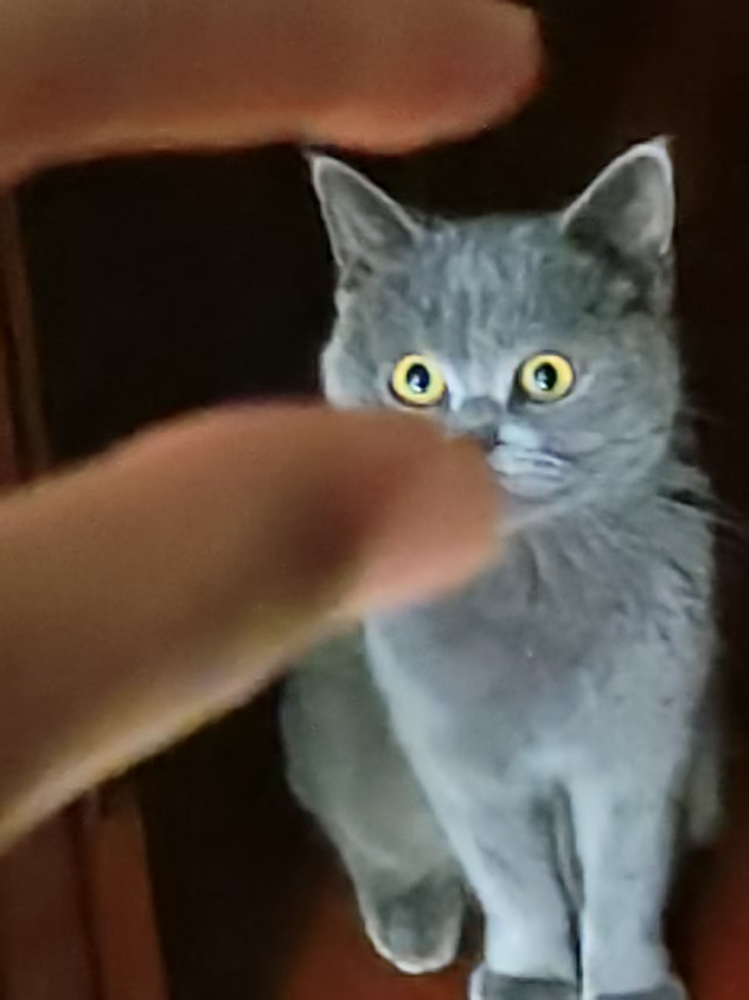
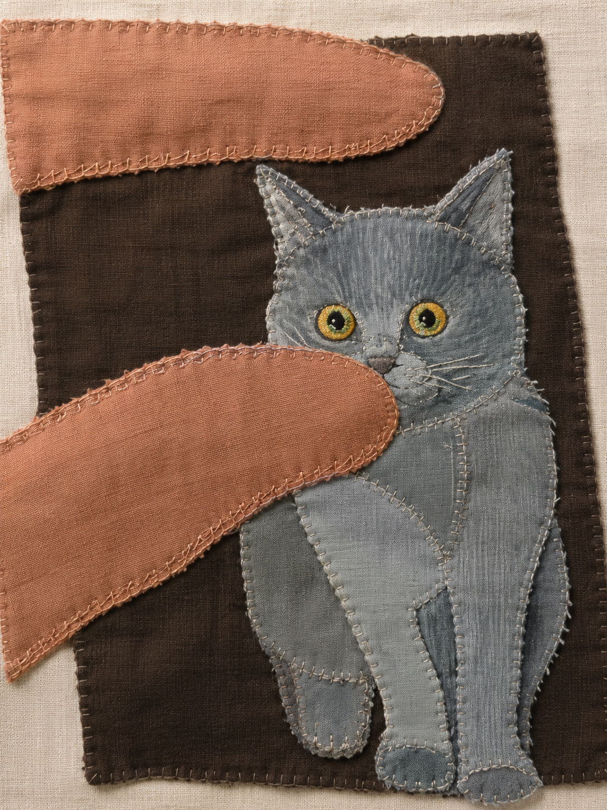

# 林间布语 · Stitch Soft Forest

把照片里的主体与记忆，转译成有布纹、针脚和层次的视觉作品。

一套面向照片风格转化与图案探索的 Agent Skill，将棉麻织纹、碎布层叠、手剪边缘、可见针脚和自然色彩组织为可复用的创作流程。适用于手缝布艺拼贴、贴布绣图像，以及布包、书封等载体的视觉概念探索。

*A visual-creation skill that translates photos and everyday memories into tactile textile-collage imagery through reusable material, composition and prompt rules.*

## 案例：把照片转译为拼布图像

| 输入参考图 | AI 生成的布艺视觉试作 |
| :---: | :---: |
|  |  |

这组试作保留了灰猫的眼神、手指与主体之间的遮挡关系，将毛发和皮肤转译为不同颜色的布片，并通过接缝、针脚和织纹建立材料感。

**示例说明：** 图片来自既有创作试作。右侧为 AI 生成的布艺视觉效果，未经过实体缝制。参考照片用于主体与空间关系的转译展示。

## 我的工作

**Yimeng Cheng / 程艺萌 · 视觉规则设计、提示词组织与效果迭代**

- **定义视觉语言：** 把“温暖、自然、手作感”落实为棉麻底布、碎布层次、手剪轮廓、针脚、接触阴影和低饱和配色等可观察的要求。
- **组织生成流程：** 将任务判断、参考图分析、提示词装配和结果检查整理为 Skill，并拆分出独立的视觉规则文件。
- **进行效果判断与迭代：** 检查主体辨识度、布片与纸片的差别、针脚合理性及构图关系，让生成结果服务于设定的视觉方向。

本项目的核心是**将设计判断转化为可复用的 AI 创作方法**。图像生成由所使用的图像工具完成。

## 可以做什么

- 将人物、动物、自然物和日常小物的照片转译为布艺拼贴图像。
- 根据一句灵感组织新的布艺场景。
- 探索布包、书封、挂布、徽章或服装贴布的图案与效果图。
- 在明确需要制作参考时，提供布片分层、布料与针法建议。

## 工作流

**判断用途 → 提炼主体与关系 → 确定材料、配色和构图 → 组织提示词 → 图像生成 → 检查与调整**

规则重点包括：真实织纹与布片厚度、可见接缝、克制的色彩、主体与留白关系，以及对纸张拼贴感、塑料感和机械绣花感的排除。

## 安装与使用

在支持 Agent Skills 的环境中，将仓库文件放入项目的：

```text
.agents/skills/stitch-soft-forest/
```

确保入口位于 `.agents/skills/stitch-soft-forest/SKILL.md`，并保留 `references`、`agents` 与 `assets` 目录。

上传参考照片后调用：

```text
使用 $stitch-soft-forest，把这张照片转化为有真实织纹、分层布片和可见针脚的手缝布艺拼贴。
保留主体的动作与空间关系。
```

也可以描述新的主题：

```text
使用 $stitch-soft-forest，设计一只小羊走过鼠尾草绿山坡的布艺画面。
```

生成实际图像需要运行环境提供可用的图像生成或编辑工具。该 Skill 提供创作规则与流程，本身不包含独立图像模型。

## 文件结构

```text
stitch-soft-forest/
├── README.md
├── SKILL.md
├── agents/openai.yaml
├── assets/icon.svg
├── references/visual-language.md
└── docs/images/
```

- [`SKILL.md`](SKILL.md)：任务适用范围、创作步骤与检查要求。
- [`visual-language.md`](references/visual-language.md)：材质、配色、造型、针脚与构图规范。
- `docs/images/`：案例参考图与生成效果。

## 参考与原创原则

参考图用于提炼主体、动作、空间关系或工艺气质；创作时重新组织轮廓、布纹与叙事关系。涉及他人作品时，不把其具体构图、图案或照片归为个人原创成果。

## 其他创意实验

- [旅行拼豆纪念册 · Travel Bead Souvenir](https://github.com/YimengCheng/travel-bead-souvenir)
- [圣诞树交互网页 · Christmas Tree 2025](https://github.com/YimengCheng/Christmas-Tree-2025)
